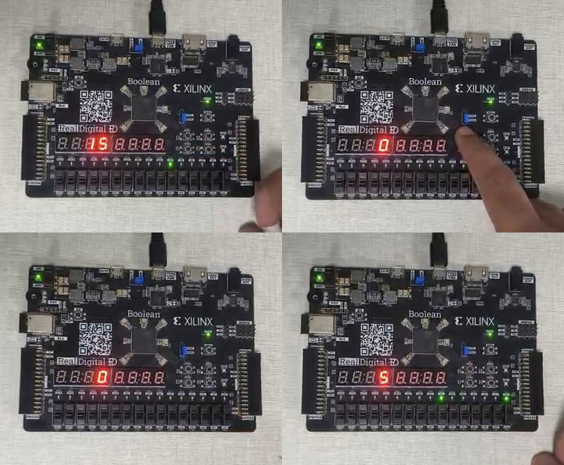
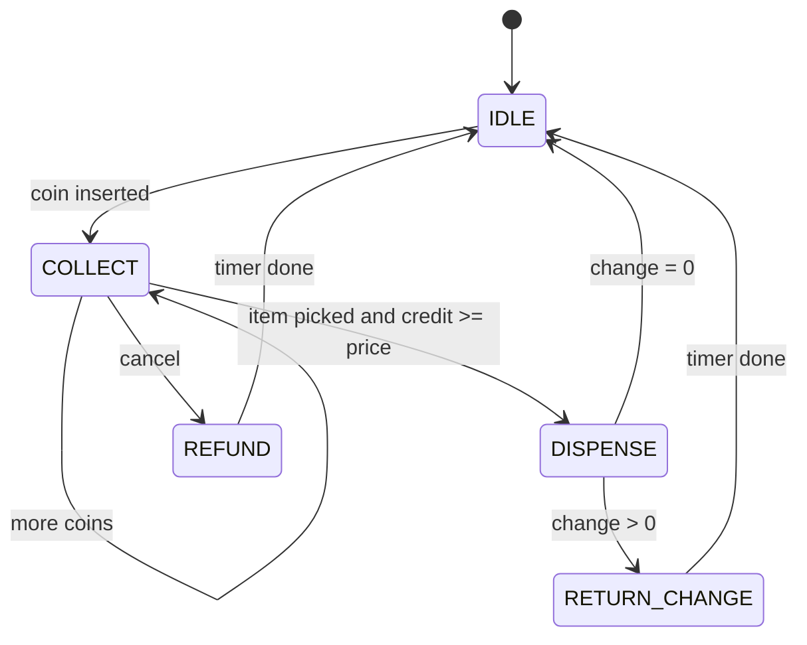
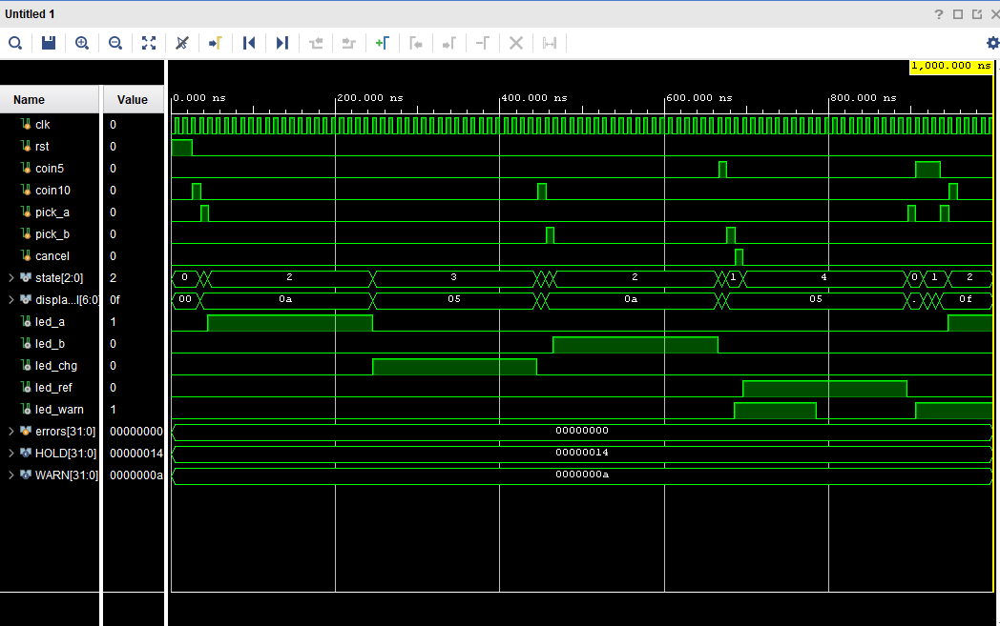

# Vending-Machine-Controller-using-FSM
A finite-state-machine (FSM) vending machine controller written in Verilog and implemented on the **Boolean board** (Xilinx Spartan-7 XC7S50).
 

-green)

 
<p align="center">
  
</p>

## Table of Contents
- [Overview](#overview)
- [Features](#features)
- [How It Works](#how-it-works)
- [Hardware Controls](#hardware-controls)
- [Repository Structure](#repository-structure)
- [Getting Started](#getting-started)
- [Simulation](#simulation)
- [Testing on the Board](#testing-on-the-board)
- [Pin Mapping](#pin-mapping)
- [Future Improvements](#future-improvements)
  
## Overview
The controller accepts ₹5 and ₹10 coins, lets the user pick one of two items, dispenses it, and returns any change. The user can also cancel to get a full refund. Credit and change are shown on the board's 7-segment display, and the LEDs show what the machine is doing.
 
## Features
- Two items: **A (₹5)** and **B (₹10)**
- Accepts **₹5** and **₹10** coins (credit saturates at ₹99)
- Change return and full refund on cancel
- Warning LED for "no coin inserted" or "not enough credit"
- Debounced buttons and switches, with rising-edge detection
- Multiplexed 7-segment display driver
- Self-checking testbench with timers shortened for simulation

## How It Works
The controller is a five-state FSM.
 

 
| State | Description | Output |
|---|---|---|
| `IDLE` | Credit is 0, waiting for a coin | Display shows `0` |
| `COLLECT` | Coins add to the credit; item picks are checked | Display shows credit |
| `DISPENSE` | Credit covers the price; the item is released for about 2 s | LED0 (item A) or LED1 (item B) |
| `RETURN_CHANGE` | Leftover credit is returned for about 2 s | LED2, display shows change |
| `REFUND` | Cancel pressed; all credit is returned for about 2 s | LED3, display shows credit |
 
Coin and cancel inputs are ignored while the machine is dispensing, returning change, or refunding.
 
## Hardware Controls
 **Inputs**
 
| Board part | Function |
|---|---|
| `BTN0` | Insert ₹5 coin |
| `BTN1` | Insert ₹10 coin |
| `BTN2` | Cancel and refund |
| `BTN3` | Reset |
| `SW0` | Flip up to pick item A (₹5) |
| `SW1` | Flip up to pick item B (₹10) |
 
> A switch triggers a pick on its **up** flip. Flip it back down before the next pick.
 
**Outputs**
 
| Board part | Meaning |
|---|---|
| 7-segment display (D0) | Credit (0 to 99), or the change amount during `RETURN_CHANGE` |
| `LED0` | Dispensing item A |
| `LED1` | Dispensing item B |
| `LED2` | Returning change |
| `LED3` | Refunding |
| `LED4` | Warning (no coin or not enough credit, about 0.5 s) |
| `LED5` to `LED7` | Current state number in binary (0 = IDLE ... 4 = REFUND) |
 
## Repository Structure
```
.
├── rtl/
│   ├── vending_top.v      # Top module (board I/O wiring)
│   ├── vending_fsm.v      # FSM, credit/change logic, timers
│   ├── debounce.v         # Synchronizer, debouncer, edge detector
│   └── seg7_mux.v         # 7-segment decoder and display multiplexer
├── tb/
│   └── tb_vending_fsm.v   # Self-checking testbench
├── constraints/
│   └── boolean_vending.xdc  # Pin mapping for the Boolean board
├── images/                # Photos and waveform used in this README
└── README.md
```
 
## Getting Started
 ### Requirements
- [Xilinx Vivado](https://www.xilinx.com/support/download.html) (any recent version with Spartan-7 support)
- Boolean board and a USB cable
  
### Build and program
1. Create a new **RTL project** in Vivado and select the Boolean board's part (`XC7S50CSGA324-1`).
2. Add the four files in `rtl/` as **design sources**.
3. Add `constraints/boolean_vending.xdc` as a **constraint**.
4. Add `tb/tb_vending_fsm.v` as a **simulation source**.
5. Set `vending_top` as the top module.
6. Run **Synthesis**, **Implementation**, then **Generate Bitstream**.
7. Connect the board, open **Hardware Manager**, and click **Program Device**.

## Simulation
1. In **Simulation Sources**, right-click `tb_vending_fsm` and choose **Set as Top**.
2. Click **Run Simulation**, then **Run Behavioral Simulation**.
3. In the Tcl console, type `run all`.
The testbench uses shortened timers and prints a `PASS` or `FAIL` line for each check. It covers:
- Overpayment with change
- Exact payment
- Insufficient credit and the warning
- Cancel and refund
- Picking with no coin inserted
- Coins ignored while dispensing
<p align="center">
  
</p>

## Testing on the Board
After programming, the display shows `0` and all LEDs are off. Start with both switches down.
 
| Test | Steps | Expected result |
|---|---|---|
| Overpay with change | Press `BTN1`, flip `SW0` up | LED0 for about 2 s, then LED2 with `5` on the display, then back to `0` |
| Exact payment | Press `BTN1`, flip `SW1` up | LED1 for about 2 s, no change |
| Not enough credit | Press `BTN0`, flip `SW1` up | LED4 blinks, nothing is dispensed |
| Refund | Press `BTN0`, press `BTN2` | LED3 with `5` on the display, then back to `0` |
| No coin | Flip `SW0` up with credit `0` | LED4 lights briefly |
| Coins add up | Press `BTN0` three times | Display shows `15` |
| Busy lock | Press a coin button while LED0 or LED1 is lit | Coin is ignored |
 
## Pin Mapping
All I/O uses 3.3 V (`LVCMOS33`). Pins come from the Boolean Board Reference Manual.
 
| Signal | Pins |
|---|---|
| `clk` (100 MHz) | F14 |
| `btn[3:0]` | J2, J5, H2, J1 |
| `sw[1:0]` | V2, U2 |
| `led[15:0]` | G1, G2, F1, F2, E1, E2, E3, E5, E6, C3, B2, A2, B3, A3, B4, A4 |
| `an[3:0]` (display D0) | D5, C4, C7, A8 |
| `seg[7:0]` (display D0) | D7, C5, A5, B7, A7, D6, B5, A6 |
 
The 7-segment display is **active low**: `seg[0]` to `seg[7]` drive segments a, b, c, d, e, f, g, and the decimal point.
 
## Future Improvements
- Add a third item
- Add a stock counter with a "sold out" indication
- Add an inactivity timeout that refunds the credit automatically 
